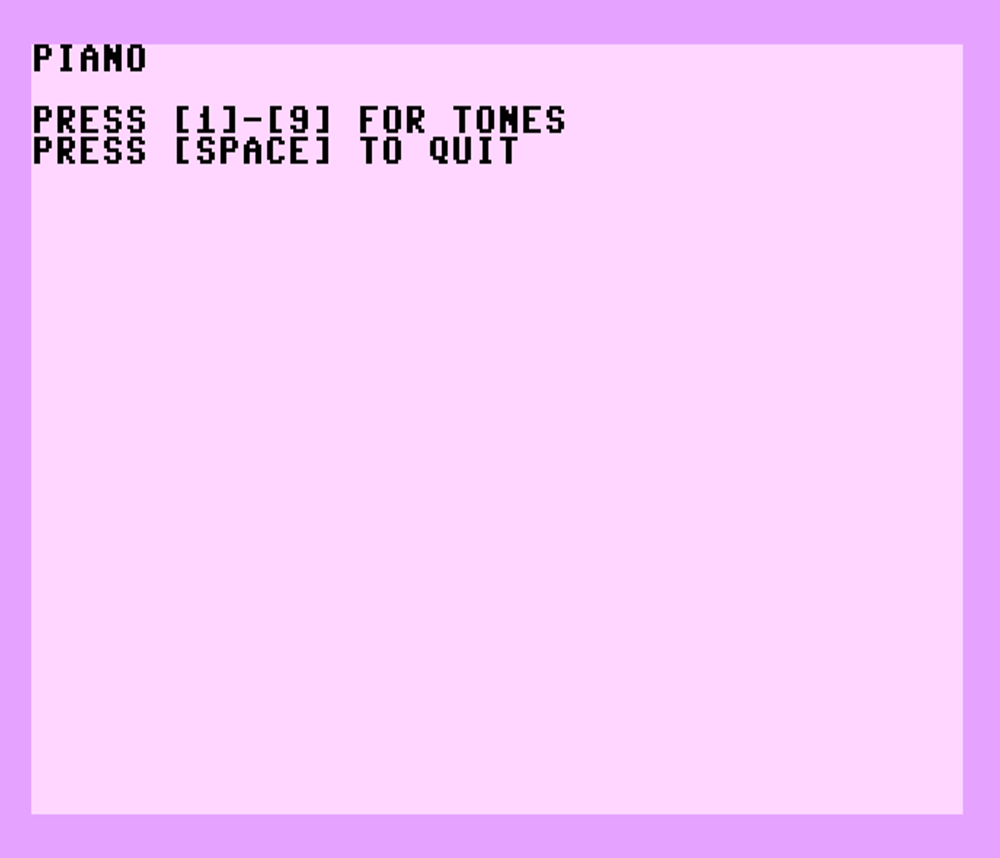

# plus4_making_some_music
Commodore's plus/4 User's Guide sample program SOUND demo

This sample has been revised by Dave Van Wagner

* Sustaining note while key pressed
* Added next node for [9] key
* Ported to C128, and [C64 (v3.5 BASIC required)](https://csdb.dk/release/?id=189017)
* Added use of [cbmdetect](https://github.com/davervw/cbmdetect) (c) 2026 David R. Van Wagner

PAL and NTSC systems supported (affects only C64 v3.5 BASIC)

Reference to published source: [Making some music](https://archive.org/details/plus-4-users-manual/page/109/mode/2up)

